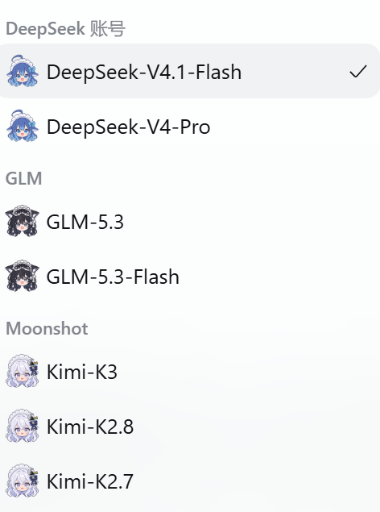
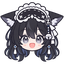
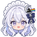

# Anime model avatars & thinking styles for DSH

[中文](README.md) | English

Character avatars for the DSH model picker, plus a per-provider replacement for the thinking indicator: when a model starts thinking, the official "Deep diving" row gets that series' icon, animation and wording. Nothing to configure after install, and it follows the light/dark theme.



## What it does

- **Avatars**: one character avatar on every row of the model picker, and before the current model name under the composer. The height tracks the font size (about 1.65em) with a 4px gap to the name.
- **Thinking styles**: the official row shows a whale tail and "Deep diving" while a model works. The plugin swaps in a series-specific icon and animation, and its own wording, while keeping the elapsed clock and the text shimmer.
- **Light/dark**: colors resolve through CSS `color-scheme` and `light-dark()`, so both themes are covered without hardcoding.
- Client-only. No runtime dependencies, no changes to shipped DSH packages.

## Supported models

Matched by provider id or model id, case-insensitive.

| Model | Avatar | Thinking icon | Animation | Label | Colors |
| --- | --- | --- | --- | --- | --- |
| DeepSeek |  | Official whale tail (kept as is) | Official | 深度求索中 (official) | Official blue |
| GLM |  |  | Tail sways around its base, ±15°, 2.4s round trip | 格物穷理中 | Pure white `#ffffff` in dark, pure black `#000000` in light |
| Kimi |  |  +  | Moon bobs and tilts slightly, sparkle twinkles | 析构万理中 | Moon-shadow gray `#a9b3bd` in dark, near black `#101317` in light |
| Qwen |  |  | Fan waves around its pivot, ±9°, 2.6s round trip | 博问通义中 | Light blue-violet `#a9a5ff` in dark, deep blue-violet `#4e49d6` in light |
| MiniMax |  |  | Camera breathes (1 → 1.06) and tilts -3° | 臻于至善中 | Light red-orange `#ff9b73` in dark, deep red-orange `#cf4a1d` in light |

DeepSeek only gets an avatar; its thinking row stays official. The whale tail and the blue already fit together, so there is nothing to improve there.

More providers will be added. Avatars and thinking styles are both table-driven, so a new series does not need a structural change.

A side-by-side sheet of the four thinking styles (Kimi, GLM, Qwen, MiniMax from top to bottom; dark on the left, light on the right) lives in [docs/thinking-preview.svg](docs/thinking-preview.svg).

## Install

- **Plugin market**: search for `dsh-anime-model-avatars` in the DSH plugin market (Discover) and install it.
- **Local directory**: developers can clone the repo and install it from that directory with the plugin manager (`plugin_manager`'s `install_bundle`, target set to the absolute repo path).

Refresh the page after installing or updating. Client-side hot reload does not always reach a page that is already open, so a refresh is the reliable path. The plugin then shows up under Settings → Plugins with its icon, title and description.

## Known limitations

- The `/model` slash-command popup renders its own list, outside the model-name slot, so avatars do not appear there.
- The thinking style repaints the official running row: original icon hidden, own glyph drawn through a mask, wording replaced in place. A major DSH release could change that row's structure, in which case the selectors need a small update.
- Avatars and icons are inlined into `client.js`, about 85 KB, mostly five 64×64 avatars.
- Web GUI only; the terminal has none of this.

## Development

```
client.js                  Client logic: avatar table, thinking-style table, injected CSS
index.js                   Host half of the plugin, an empty apply
cordis.patch.yml           Loader patch that inserts one plugin row
locale/{zh,en}.json        Title and description shown in the plugin list
icon.png                   Plugin list artwork
docs/thinking-preview.svg  Side-by-side preview of the four thinking styles
assets/                    Avatars, icons and the screenshot used by the READMEs
```

Adding a model series touches three places:

1. One entry in `AVATARS`: `{ src: avatar data URI, provider: /…/i, model: /…/i }`.
2. One entry in `THINKING_STYLES`: an icon (`svgMask(...)` around a 16×16 stroked SVG), a label, `fallback` and `themed` palettes, and an animation name.
3. One branch in `thinkingStyleOf()` returning the new style name.

Run `node --check client.js` afterwards and restart the plugin. For avatars, trim the transparent border, pad to a square, downscale to 64×64 and inline it as a data URI.

## License

MIT, by [chinokoyuki](https://github.com/chinokoyuki).
