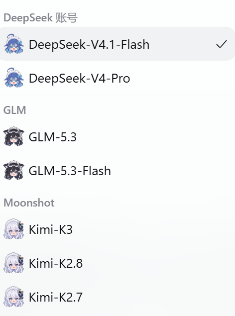

# DSH 二次元模型头像与思考样式

中文 | [English](README.en.md)

给 DSH 的模型选择列表和输入框下方的模型名加上角色头像；模型开始思考时，把官方的运行提示换成对应系列的图标、动画和文案。装好后不用配置，深浅色主题自动跟随。



## 做了什么

- **头像**：模型选择列表的每一行、以及输入框下方当前模型名的左侧，都会显示该系列的头像。高度随字号（约 1.65em），与模型名之间留 4px。
- **思考样式**：官方在模型思考时显示鲸鱼尾巴和「深度求索中」。插件按系列换成自己的图标和动画，文案也一并替换；「，用时 N 秒 ···」这段计时和文字的流光扫过保留。
- **深浅色**：颜色用 CSS 的 `color-scheme` 和 `light-dark()` 自动切换，不写死主题。
- 纯客户端实现，没有运行时依赖，不改动 DSH 官方包。

## 当前支持的模型

按 provider id 或 model id 匹配，大小写不敏感。

| 模型 | 头像 | 思考图标 | 动画 | 文案 | 配色 |
| --- | --- | --- | --- | --- | --- |
| DeepSeek |  | 官方鲸鱼尾巴（不替换） | 官方动画 | 深度求索中（官方） | 官方蓝 |
| GLM |  |  | 狐尾以尾根为轴左右摆动，±15°，2.4 秒往返 | 格物穷理中 | 深色纯白 `#ffffff`，浅色纯黑 `#000000` |
| Kimi |  |  +  | 月亮上下轻浮并小角度摆动，旁边星光闪烁 | 析构万理中 | 深色月影灰 `#a9b3bd`，浅色近黑 `#101317` |
| Qwen |  |  | 折扇以扇钉为轴轻摇，±9°，2.6 秒往返 | 博问通义中 | 深色浅蓝紫 `#a9a5ff`，浅色深蓝紫 `#4e49d6` |
| MiniMax |  |  | 相机呼吸缩放（1 → 1.06）并轻摆 -3° | 臻于至善中 | 深色浅红橙 `#ff9b73`，浅色深红橙 `#cf4a1d` |

DeepSeek 一行只加头像、思考提示保持官方样式：官方那套鲸鱼尾巴和蓝色本身比较协调，没必要动。

后续会继续补充更多提供方。头像和思考样式都按系列配置，加一款不用改结构。

四种思考样式的对照图（上到下：Kimi、GLM、Qwen、MiniMax；左深色右浅色）在 [docs/thinking-preview.svg](docs/thinking-preview.svg)。

## 安装

直接从 GitHub 安装。在 DSH 里把安装目标设为：

```
git+https://github.com/chinokoyuki/dsh-anime-model-avatars.git
```

需要固定版本时，可在地址末尾加 `#` 和完整 commit SHA。

仓库带有 `dsh-plugin` topic，可通过 GitHub 搜索发现。不同插件市场有各自的索引和审核流程，打标不代表已经收录；暂时搜不到时，仍可用上面的 Git 地址直接安装。

装好或更新后刷新一次页面。客户端插件的热更新不一定会送达已经打开的页面，刷新最稳。在设置 → 插件里能看到它，带图标、标题和说明。

## 已知限制

- `/model` 斜杠命令弹出的模型列表走命令弹窗自己的渲染，不经过模型名这个槽位，那里不会显示头像。
- 当前思考文案替换只识别中文界面的「深度求索中」；英文界面的原文不会替换，头像与图标样式不受这一文字匹配条件影响。
- 思考样式目前按页面处理，尚未隔离同页的多个会话；不同模型可能互相影响。切换模型或禁用插件后，旧文案可能保留到宿主重新渲染，刷新页面可恢复。
- 思考样式是对官方运行状态那一行做的重绘：隐藏原图标、用遮罩画自己的图形，并就地替换文案。DSH 大版本升级如果改了这一行的结构，可能需要跟着改选择器。
- 头像和图标都内联在 `client.js` 里，文件约 85 KB，主要是 5 张 64×64 头像。
- 只在 Web GUI 生效，终端里没有。

## 开发

```
client.js                  客户端逻辑：头像表、思考样式表、注入的 CSS
index.js                   Host 半个插件，只有空的 apply
cordis.patch.yml           加载器补丁，插入一个插件行
locale/{zh,en}.json        插件列表里的标题和描述
icon.png                   插件列表图标
docs/thinking-preview.svg  四种思考样式的对照预览
assets/                    README 用到的头像、图标和截图
```

加一个模型系列要改三处：

1. `AVATARS` 里加一条：`{ src: 头像的 data URI, provider: /…/i, model: /…/i }`。
2. `THINKING_STYLES` 里加一项：图标（用 `svgMask(...)` 包一段 16×16 的描边 SVG）、文案、`fallback` 和 `themed` 两套颜色、动画名。
3. `thinkingStyleOf()` 里加分支，返回新的样式名。

改完先 `node --check client.js`，再重启插件看效果。头像建议裁掉透明边距、补成正方形后缩到 64×64，内联成 data URI。

仓库 topics 和 `package.json` 的 keywords 都带 `dsh-plugin`，用于插件发现。发布新版本时同步更新 `package.json` 的 `version`，并新增 tag，不覆盖已有版本标签。

## 素材来源与许可

代码采用 [MIT 许可](LICENSE)，由 [chinokoyuki](https://github.com/chinokoyuki) 维护。

模型头像和插件图标由维护者提供，来源包括非商用二创与 AI 生成。这些图片及客户端内嵌的对应图像数据**不属于代码的 MIT 授权范围**，仅用于非商业展示和交流，请勿出售图片或将其用于商业宣传。截图中的角色图也遵循相同说明。

角色、商标及原作品的权利归相应权利人所有；二创或 AI 生成不代表取得了原作品的商业授权。本项目不代表相关模型厂商。素材范围和说明见 [ASSETS.md](ASSETS.md)；如需补充署名或处理素材权益，请通过 [Issues](https://github.com/chinokoyuki/dsh-anime-model-avatars/issues) 联系。
